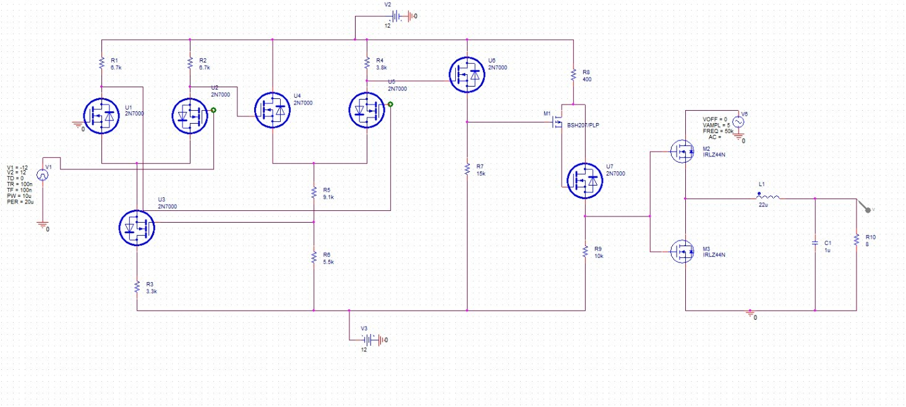
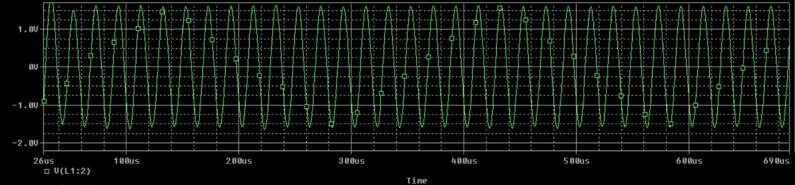

# Circuit-Level Class-D Reference

## Purpose

This folder contains the circuit-level reference for the Class-D power-amplifier stage used in the research workflow. It documents the silicon-based switching implementation that supplies the baseline for comparison with the GaN HEMT device model.

## Use Case

The circuit is used to:

- demonstrate a practical switching Class-D topology;
- apply complementary switching signals to a high-side/low-side output stage;
- pass the switched waveform through an LC low-pass filter;
- drive a resistive load;
- inspect the time-domain output waveform; and
- establish the circuit context for efficiency, gain, and loss calculations.

## Included Artifacts

| File | Description |
|---|---|
| [`circuit.jpeg`](./circuit.jpeg) | Schematic image showing the input source, driver network, MOSFET switching stage, LC filter, and load |
| [`graph.jpeg`](./graph.jpeg) | Simulated time-domain waveform at the filtered output node |

The schematic shows a 12 V supply, a driver network built from 2N7000 devices, IRLZ44N output MOSFETs, a 22 µH inductor, a 1 µF capacitor, and an 8 Ω load. The waveform image covers approximately 26–690 µs and is intended as a visual record of the simulation.

*Figure: Reference Class-D circuit schematic.*

*Figure: Simulated filtered output waveform.*

## Analysis Checklist

For a complete circuit-level reproduction, measure:

1. input power $P_{in}$;
2. load/output power $P_{out}$;
3. efficiency $\eta = P_{out}/P_{in}$;
4. input and output voltage/current amplitudes;
5. voltage gain and power gain;
6. switching frequency and duty-cycle behavior;
7. ripple after the LC filter; and
8. conduction and switching losses where device models provide the required data.

The native Multisim project and raw measurement export are not included. The images should therefore be treated as reference evidence, not as a fully reproducible Multisim source package.
