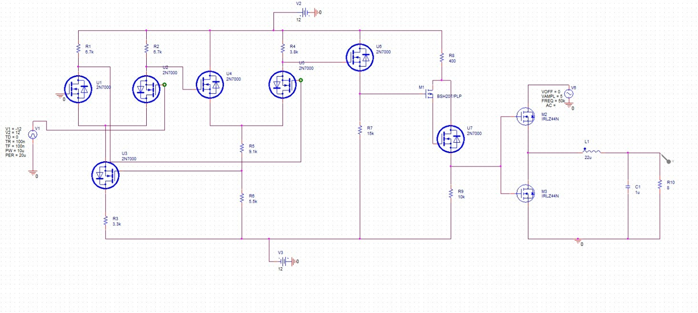
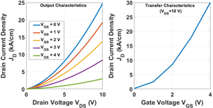
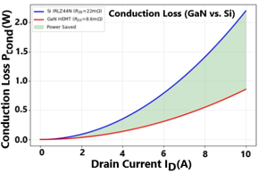

# TCAD-Based Investigation of GaN HEMTs for High-Efficiency Class-D Power Amplifier Applications 

## Introduction

This repository contains the simulation artifacts, figures, device models, and manuscript for a research study comparing semiconductor technologies used in a Class-D power amplifier. The central comparison is between a conventional silicon MOSFET implementation and a direct GaN AlGaN/GaN high-electron-mobility transistor (HEMT) device model.

The study follows a device-to-system workflow:

`Class-D circuit simulation → GaN device-level TCAD simulation → parameter extraction → loss and efficiency comparison → IEEE paper`

The project uses National Instruments (NI) Multisim for the circuit-level amplifier, DEVSIM as the open-source TCAD implementation, and ParaView for inspection of exported VTK/VTU device data. Cogenda Visual TCAD and MATLAB are identified as recommended tools in the project notes, while the repository currently contains the DEVSIM and ParaView artifacts.

## Problem Statement

Conventional silicon switching devices can limit the efficiency, switching speed, thermal performance, and power density of high-frequency power amplifiers. This work investigates whether a wide-bandgap GaN HEMT can improve the relevant performance measures of a Class-D power amplifier when compared with the silicon reference device.

The research question is:

> Can a direct GaN semiconductor device provide better electrical and loss performance than the indirect/conventional silicon implementation used in the Class-D amplifier?

## Aim and Objectives

The aim is to demonstrate that the direct GaN semiconductor device offers better performance than the conventional silicon device for the selected Class-D power amplifier application.

The objectives are to:

1. Select and simulate a practical switching Class-D power amplifier circuit.
2. Use a silicon FET/MOSFET reference implementation at circuit level.
3. Model an AlGaN/GaN HEMT at device level using TCAD.
4. Extract output and transfer characteristics, carrier concentration, potential distribution, on-resistance, transconductance, threshold behavior, and related figures of merit.
5. Calculate conduction loss and estimate the resulting amplifier-efficiency improvement.
6. Present the comparison in an IEEE-style research paper.

## Table of Contents

- [Introduction](#introduction)
- [Problem Statement](#problem-statement)
- [Aim and Objectives](#aim-and-objectives)
- [Research Roadmap](#research-roadmap)
- [Repository Structure](#repository-structure)
- [Key Results](#key-results)
- [Method and Equations](#method-and-equations)
- [Getting Started](#getting-started)
- [Reproducing the Simulations](#reproducing-the-simulations)
- [Reading the Results](#reading-the-results)
- [Publication Status](#publication-status)
- [Scope and Limitations](#scope-and-limitations)
- [License](#license)

## Research Roadmap

### Part I — NI Multisim circuit simulation

The circuit phase establishes the Class-D reference amplifier and provides the silicon baseline.

- Select a practical switching Class-D topology.
- Use silicon FET devices as the reference switching elements.
- Simulate the input, switching waveform, filtered output, and load response.
- Determine efficiency and efficiency percentage using measured input and output power.
- Determine input gain and output gain.
- Report at least four performance parameters, including efficiency, with supporting calculations.

The circuit schematic and waveform are in [`Circuitry/`](./Circuitry/). The repository includes reference images rather than a native Multisim project file.

### Part II — TCAD GaN device simulation

The device phase evaluates the proposed GaN technology independently of the circuit schematic.

- Build a one-dimensional multilayer AlGaN/GaN HEMT structure.
- Define material permittivity, doping, contacts, and layer interfaces.
- Solve Poisson’s equation and electron continuity using a drift-diffusion formulation.
- Sweep drain voltage and gate voltage to obtain output and transfer characteristics.
- Extract device parameters and visualize potential and electron concentration.
- Export the solved regions to VTK/VTU for ParaView.

The implementation is in [`TCAD/DEVSIM/`](./TCAD/DEVSIM/), and the exported visualization data is in [`TCAD/ParaView/`](./TCAD/ParaView/).

### Part III — Compilation and paper formation

The circuit and device results are combined into the manuscript. The comparison focuses on semiconductor technology, on-state resistance, breakdown capability, gate control, current transport, conduction loss, switching suitability, and projected Class-D efficiency.

## Repository Structure

| Location | Purpose |
|---|---|
| [`Circuitry/`](./Circuitry/) | Class-D reference circuit schematic and simulated waveform |
| [`Results/`](./Results/) | Generated plots, contours, device structure, and comparison figures |
| [`TCAD/`](./TCAD/) | TCAD workflow and visualization subprojects |
| [`TCAD/DEVSIM/`](./TCAD/DEVSIM/) | DEVSIM Python model and Google Colab notebook |
| [`TCAD/ParaView/`](./TCAD/ParaView/) | VTK multiblock descriptors and per-region VTU exports |
| [`ICCoSD-26_Manuscript.pdf`](./ICCoSD-26_Manuscript.pdf) | Current manuscript submitted for the conference |
| [`requirements.txt`](./requirements.txt) | Python package requirements for the DEVSIM workflow |
| [`softwares-and-libraries.txt`](./softwares-and-libraries.txt) | Recommended commercial and open-source tools |
| [`LICENSE`](./LICENSE) | MIT license |

## Key Results

The manuscript reports the following results under its adopted modeling assumptions:

| Metric | Silicon reference (IRLZ44N) | Proposed GaN HEMT |
|---|---:|---:|
| On-state resistance, $R_{DS(on)}$ | 22 mΩ | 8.6 mΩ |
| Breakdown voltage | 55 V | >600 V |
| Bandgap | 1.12 eV | 3.4 eV |
| Conduction loss at 10 A | 2.2 W | approximately 0.86 W |
| Conduction-loss reduction | — | approximately 61% |
| Projected Class-D efficiency | 91.53% | nearly 97.0% |
| Channel mechanism | Inversion channel | Gate-controlled polarization-induced 2DEG |
| Operating mode | Conventional silicon reference | Direct GaN HEMT device |

These are analytical and simulation-based results. They are not a substitute for switching-loss measurements or hardware validation.

## Method and Equations

### Class-D efficiency

$$
\eta = \frac{P_{out}}{P_{in}} \times 100\%
$$

where $P_{in}$ is the electrical input power and $P_{out}$ is the delivered load power.

### Total modeled loss

$$
P_{loss} = P_{cond} + P_{sw}
$$

where $P_{cond}$ is conduction loss and $P_{sw}$ is switching loss.

### Conduction loss

$$
P_{cond} = I_{D,rms}^{2} R_{DS(on)}
$$

The repository’s conduction-loss comparison uses $R_{DS(on)} = 22$ mΩ for the silicon reference and the extracted/projected GaN value for the HEMT.

### Class-D output filter

$$
f_c = \frac{1}{2\pi\sqrt{LC}}
$$

The LC filter suppresses switching-frequency components while passing the reconstructed output waveform.

### HEMT device equations

The DEVSIM workflow solves a discretized electrostatic Poisson equation together with electron drift-diffusion/continuity equations. It uses region-specific permittivity, doping, mobility, contact boundary conditions, and interface continuity models. The AlGaN/GaN interface is examined for the high-density two-dimensional electron gas (2DEG) that supports low channel resistance.

## Getting Started

### Prerequisites

- Python 3.8 or later.
- `pip`; a virtual environment is recommended.
- Linux or Google Colab for the DEVSIM notebook workflow. The notebook contains Colab package-install and download cells.
- ParaView for interactive inspection of VTU/VTK exports.
- NI Multisim for reproducing the circuit simulation. A native Multisim project is not included.

### Install Python dependencies

```powershell
python -m venv .venv
.venv\Scripts\activate
python -m pip install --upgrade pip
python -m pip install -r requirements.txt
```

The pinned DEVSIM requirement is `devsim==2.1.2`; NumPy, SciPy, and Matplotlib are also required. The notebook records a DEVSIM 2.10.0 Colab run, so exact numerical reproduction may require aligning the environment with the recorded notebook version.

## Reproducing the Simulations

### DEVSIM

1. Open [`TCAD/DEVSIM/GaN_FET_TCAD_Simulation.ipynb`](./TCAD/DEVSIM/GaN_FET_TCAD_Simulation.ipynb) in Google Colab or a compatible Jupyter environment.
2. Run the cells in order. The workflow initializes the solver, builds a test mesh, creates the GaN/AlGaN structure, applies physics and contacts, solves the equilibrium state, sweeps $V_{DS}$ and $V_{GS}$, extracts parameters, plots results, and exports VTK data.
3. Use [`TCAD/DEVSIM/gan_fet_tcad_simulation.py`](./TCAD/DEVSIM/gan_fet_tcad_simulation.py) as the script-form reference. It contains notebook-oriented cells and Colab-specific commands, so it may require conversion before execution as a plain Python script.

### ParaView

1. Open [`TCAD/ParaView/GaN_HEMT_1D_Data.vtm`](./TCAD/ParaView/GaN_HEMT_1D_Data.vtm) in ParaView.
2. Inspect the five blocks corresponding to the exported device regions.
3. Color the mesh by fields such as `Potential`, `Electrons`, `NetDoping`, `Permittivity`, or `mu_n`.
4. Use the `.visit` files when a reader or workflow requires a VisIt-style collection descriptor.

The folder contains two similarly named export sets. Prefer the `GaN_HEMT_1D_Data.vtm` descriptor and its `GaN_HEMT_1D_Data_*.vtu` files as the clean export set; retain the alternate `*.vtu.vtm` set for compatibility with the original export naming.

## Reading the Results



*Figure: Class-D switching circuit used as the silicon reference.*



*Figure: Simulated output-characteristic family and transfer characteristic.*



*Figure: Modeled conduction-loss comparison between the silicon and GaN devices.*

- [`Results/output_&_transfer_Graphs.png`](./Results/output_&_transfer_Graphs.png) shows the output-characteristic family and transfer characteristic.
- [`Results/Conduction_Loss_Graph.png`](./Results/Conduction_Loss_Graph.png) compares modeled Si and GaN conduction loss.
- [`Results/Spatial_Electron_Concentration_Profile.png`](./Results/Spatial_Electron_Concentration_Profile.png) shows the carrier-concentration profile and 2DEG interface marker.
- [`Results/Electrostatic_PD_Graph.png`](./Results/Electrostatic_PD_Graph.png) shows potential through the multilayer stack.
- [`Results/ElectronConc_Contour.png`](./Results/ElectronConc_Contour.png) and [`Results/Electrostatic_PD_Contour.png`](./Results/Electrostatic_PD_Contour.png) provide ParaView-style field contours.
- [`Results/GaN_Structure.png`](./Results/GaN_Structure.png) documents the modeled layer stack and contacts.

## Publication Status

The paper was accepted at ICCoSD 2026 under Paper ID **269**. The full release is pending publication in IEEE Xplore, expected in December 2026 according to the project status supplied with this repository.

The current manuscript is available at [`ICCoSD-26_Manuscript.pdf`](./ICCoSD-26_Manuscript.pdf).

This manuscript and this Conference paper was the joint effort of my research partners and 2 Professor Guides. I remain very grateful to them for giving me opportunity on working on such a project. Looking forward to working more with them :)

Guides - 
- Dr. Mahendra Kr. Das - Associate Professor, Dept. of ECE
- Dr. Payal Bharadwaj - Assistant Professor, Dept. of ECE

Research Partners - 
- Srishti - BTECH/60002/24, Dept. of ECE
- Khushi - BTECH/60009/24, Dept. of ECE

## Scope and Limitations

- The GaN-to-silicon efficiency comparison uses an analytical loss model and extracted device parameters.
- Switching losses, gate-drive losses, parasitic effects, thermal coupling, and hardware measurements are outside the current validation scope.
- The DEVSIM notebook is a one-dimensional device model. It is useful for parameter investigation and visualization, but it does not replace a calibrated multidimensional production-device model.
- The generated VTU files contain compressed/binary field arrays and should be opened through a VTK-compatible viewer rather than edited manually.
- Some implementation values in the DEVSIM model and paper tables represent different modeling revisions; cite the manuscript for reported paper values and the source code/notebook for executable model values.

## Future Work

- Push forward towards building the project in 3 - Dimensional device model for better accuracy and parameter investigation.

## License

This project is released under the [MIT License](./LICENSE).
