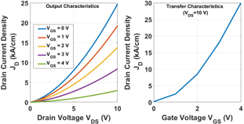
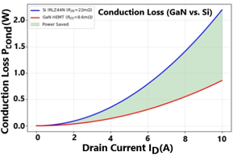
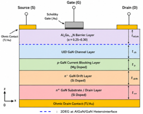

# Simulation Results

## Purpose

This folder contains the rendered figures used to interpret the circuit and TCAD work. The images are presentation artifacts generated from the Class-D reference circuit and the GaN HEMT device workflow.

## Figures

*Output-characteristic family and transfer characteristic.*

*Modeled conduction-loss comparison between the silicon and GaN devices.*

*Cross-sectional structure of the modeled GaN HEMT.*

| File | Interpretation |
|---|---|
| [`output_&_transfer_Graphs.png`](./output_&_transfer_Graphs.png) | Output-characteristic family and transfer characteristic |
| [`Conduction_Loss_Graph.png`](./Conduction_Loss_Graph.png) | Modeled conduction-loss comparison between Si and GaN |
| [`GaN_Structure.png`](./GaN_Structure.png) | Cross-sectional layer stack, contacts, and 2DEG interface |
| [`Spatial_Electron_Concentration_Profile.png`](./Spatial_Electron_Concentration_Profile.png) | Electron concentration versus device depth, including the 2DEG interface marker |
| [`ElectronConc_Contour.png`](./ElectronConc_Contour.png) | Electron-concentration contour exported/visualized from the device solution |
| [`Electrostatic_PD_Contour.png`](./Electrostatic_PD_Contour.png) | Electrostatic-potential contour through the device |
| [`Electrostatic_PD_Graph.png`](./Electrostatic_PD_Graph.png) | Potential distribution across the GaN stack |

## How to Use These Results

Use the figures to connect each reported claim to an observable:

- $I$-$V$ curves → gate control and current transport
- electron profile/contour → 2DEG formation and carrier confinement
- potential profile/contour → voltage sharing and drift-region behavior
- conduction-loss plot → effect of $R_{DS(on)}$ on modeled power dissipation

The figures are static outputs. For field values, region selection, alternate color maps, and additional probing, open the source VTU multiblock data in [`../TCAD/ParaView/`](../TCAD/ParaView/).

## Reported Comparison

The manuscript uses 8.6 mΩ for the proposed GaN HEMT and 22 mΩ for the IRLZ44N silicon reference. At 10 A, the corresponding modeled conduction losses are approximately 0.86 W and 2.2 W. The resulting reduction is approximately 61%, supporting the projected Class-D efficiency improvement from 91.53% to nearly 97.0% under the stated analytical assumptions.
