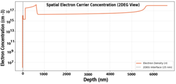
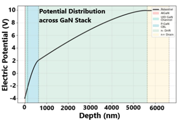

# DEVSIM GaN HEMT Model

## Purpose

This folder contains the DEVSIM implementation of the one-dimensional GaN HEMT device simulation. It is the computational source for the electrical curves, extracted device parameters, and VTK exports used by the rest of the repository.

## Files

| File | Purpose |
|---|---|
| [`GaN_FET_TCAD_Simulation.ipynb`](./GaN_FET_TCAD_Simulation.ipynb) | Cell-by-cell Colab/Jupyter workflow with setup, model construction, sweeps, plots, and export |
| [`gan_fet_tcad_simulation.py`](./gan_fet_tcad_simulation.py) | Script-form copy of the model logic |

## Workflow

1. Install/import DEVSIM, NumPy, SciPy, and Matplotlib.
2. Create and validate a basic one-dimensional test mesh.
3. Define physical constants, permittivities, doping concentrations, layer thicknesses, contacts, and interfaces.
4. Initialize node models and solve the electrostatic Poisson equation.
5. Add electron variables and Scharfetter–Gummel drift-diffusion transport.
6. Apply gate and drain boundary conditions and attach contact-current measurements.
7. Sweep $V_{DS}$ from 0 to 10 V at $V_{GS}=0$ V.
8. Generate a family of curves for $V_{GS} = 0,-1,-2,-3,-4$ V in the implementation.
9. Extract $R_{DS(on)}$, transconductance, threshold estimate, peak current, and ON/OFF ratio.
10. Plot potential, mesh spacing, electron concentration, and conduction-loss comparison.
11. Export the device regions to VTK/VTU files for ParaView.

## Execution Notes

The notebook includes Google Colab-specific commands such as `!pip install` and `google.colab.files`. Run it in Colab or remove/adapt those cells for a local Jupyter environment. The `.py` file is a source reference but should also be reviewed before running as a plain Python module because it preserves notebook-oriented sections.

The repository requirement file pins DEVSIM to 2.1.2, while the notebook records a Colab run using DEVSIM 2.10.0. Use a consistent environment when comparing numerical results.

## Model Interpretation

*Figure: Simulated spatial electron concentration and the marked 2DEG interface.*

*Figure: Simulated electrostatic potential across the GaN stack.*

The simulation is a one-dimensional drift-diffusion investigation, not a calibrated full power-amplifier model. It provides device-level evidence for the manuscript’s GaN comparison. The projected amplifier efficiency additionally depends on the analytical loss model and assumptions described in the root [README](../../README.md).
