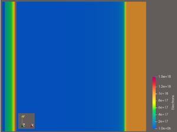
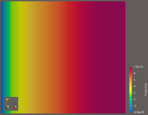

# ParaView Export Data

## Purpose

This folder contains the structured VTK/VTU export produced by the DEVSIM GaN HEMT workflow. The files allow the solved one-dimensional device regions and their scalar fields to be inspected in ParaView or another VTK-compatible viewer.

## Recommended Entry Point

Open [`GaN_HEMT_1D_Data.vtm`](./GaN_HEMT_1D_Data.vtm). It is a VTK multiblock descriptor that references five region files:

```text
GaN_HEMT_1D_Data_0.vtu
GaN_HEMT_1D_Data_1.vtu
GaN_HEMT_1D_Data_2.vtu
GaN_HEMT_1D_Data_3.vtu
GaN_HEMT_1D_Data_4.vtu
```

The blocks correspond to the five modeled device regions. Each VTU file contains 251 points and 250 one-dimensional cells in the exported dataset and includes fields such as `Potential`, `Electrons`, `NetDoping`, `Permittivity`, `mu_n`, contact boundary models, and transport helper models.

## Alternate Export Set

The folder also contains [`GaN_HEMT_1D_Data.vtu.vtm`](./GaN_HEMT_1D_Data.vtu.vtm), its `.visit` descriptor, and files named `GaN_HEMT_1D_Data.vtu_*.vtu`. These represent the same kind of five-block export with an alternate filename prefix retained from an earlier export.

## Basic ParaView Workflow



*Figure: Electron concentration contour generated from the exported device solution.*



*Figure: Electrostatic potential contour generated from the exported device solution.*

1. Open the recommended `.vtm` file.
2. Apply **Color By** to `Potential`, `Electrons`, `NetDoping`, or `Permittivity`.
3. Use a logarithmic color scale for electron concentration when the range spans several orders of magnitude.
4. Inspect the AlGaN/GaN interface for the localized 2DEG concentration peak.
5. Inspect the potential field across the drift layer to evaluate voltage distribution.
6. Use **Plot Over Line** or a data export when numerical profiles are required.

The VTU files use compressed/binary arrays and should not be edited manually. Regenerate them from the DEVSIM workflow when model parameters change.
