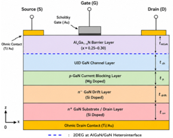

# TCAD Device Simulation

## Purpose

This folder contains the device-level portion of the project. It models a multilayer AlGaN/GaN HEMT, extracts electrical and physical characteristics, and prepares field data for visualization.

## Use Case

The TCAD workflow supports the research question by linking semiconductor structure to amplifier-relevant performance:

`material and doping definition → electrostatic solution → carrier transport → I-V extraction → loss estimate → visualization`

The model is used to investigate:

- output characteristics $I_D$-$V_{DS}$;
- transfer characteristics $I_D$-$V_{GS}$;
- on-state resistance;
- transconductance;
- threshold behavior and ON/OFF ratio;
- potential distribution through the device;
- electron concentration and 2DEG formation; and
- comparative Si/GaN conduction loss.

## Subfolders

| Folder | Purpose |
|---|---|
| [`DEVSIM/`](./DEVSIM/) | Executable Python and notebook implementation of the one-dimensional HEMT model |
| [`ParaView/`](./ParaView/) | VTK multiblock descriptors and per-region VTU files exported from DEVSIM |

## Device Stack

*Figure: Modeled AlGaN/GaN HEMT layer stack and contacts.*

The implementation creates regions for an AlGaN barrier, UID GaN channel, p-GaN current-blocking layer, n- GaN drift layer, and n+ GaN drain layer. It defines gate and drain contacts and stitches the internal interfaces so that potential and electron variables remain continuous across the stack.

## Relationship to the Paper

The TCAD results in this folder support the manuscript’s claims about 2DEG formation, gate control, voltage distribution, current transport, and reduced on-resistance. Refer to the root [README](../README.md) for the reported comparison and reproduction boundaries.
